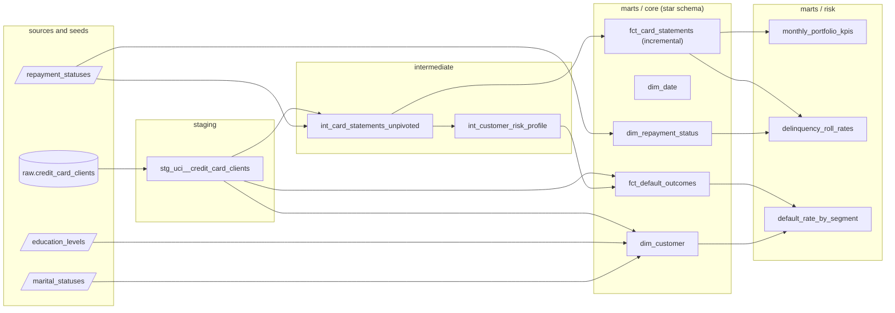

# Banking analytics with dbt

A dbt project that turns a public credit card dataset (30,000 clients of a Taiwanese bank, April-September 2005) into a star schema and three credit-risk marts: monthly portfolio KPIs, delinquency roll rates and default rates by segment.
It is a portfolio piece for Analytics Engineering reviewers: it runs end to end on DuckDB with no credentials, and CI rebuilds and tests it on every push.

## Highlights

- 11 models in four layers (source → staging → intermediate → marts) plus 3 seeds; a star schema with two facts and three dimensions.
- 91 tests: 85 generic data tests, 4 singular business tests and 2 unit tests. `dbt build` takes under 5 seconds on a laptop.
- An incremental fact (`merge` on a composite key) and SQL limited to dbt's cross-database macros, with a BigQuery profile template.
- Source data issues are documented rather than hidden: undocumented codes go to `unknown` through seeds, and a warn-level test counts a break in the repayment-status coding.

## Lineage



`dim_date` is generated with `dbt.date_spine`; both facts reference it, as `dbt docs serve` shows in the full lineage graph.

## How to run

Requires Python 3.10-3.13 and internet access for the first download (5.5 MB from UCI).

```bash
git clone https://github.com/marcmaldonadolorca/banking-analytics-dbt.git
cd banking-analytics-dbt
python3.12 -m venv .venv          # any Python 3.10-3.13
source .venv/bin/activate
pip install -r requirements.txt
python scripts/load_raw.py        # download, verify SHA-256, write data/banking.duckdb
dbt build                         # seeds, models, data tests and unit tests
```

Optional:

```bash
dbt show --select monthly_portfolio_kpis      # preview a mart
dbt docs generate && dbt docs serve           # docs and lineage at http://localhost:8080
dbt build --select fct_card_statements+       # second run: incremental merge of the latest month
```

`profiles.yml` in the project root points to `data/banking.duckdb`; set `DUCKDB_PATH` to use another file.

## Data

**Source:** Yeh, I.-C. (2009). *Default of Credit Card Clients* [Dataset]. UCI Machine Learning Repository. https://doi.org/10.24432/C55S3H. **License:** CC BY 4.0.
One row per client: credit limit, demographics, six monthly statements (repayment status, balance, payment) in wide format, and whether the client defaulted in October 2005. The file is not stored in this repository: `scripts/load_raw.py` downloads it, checks its SHA-256, and lands it unchanged (apart from snake_case column names) as `raw.credit_card_clients`.

The PKDD'99 "financial" (Berka) dataset was the first choice, but neither the original challenge page nor the CTU relational repository states a license, and the mirror is a database server reached with shared credentials.

Issues found while profiling, and how the project handles them:

| Finding | Handling |
|---|---|
| Repayment status is `pay_0, pay_2 … pay_6` (no `pay_1`) while balances and payments are `1 … 6` | Renamed by month once in staging, covered by a unit test |
| Education codes 0, 5 and 6 (345 clients) and marital status 0 (54 clients) are undocumented | Mapped to `unknown` in seeds; source `accepted_values` tests catch any new code |
| Repayment codes -2 and 0 are undocumented on the UCI page | Read as "no consumption" and "revolving credit", the meaning commonly attributed to the author; flagged `is_documented = false` |
| Status 1 (one month late) occurs 3,688 times in September but at most 28 times in any earlier month, where accounts jump from current straight to two months late | A warn-level test counts the 6,209 jumps; delinquency trends should be read on April-August only |
| 1,930 clients have a negative balance in at least one month | Treated as a credit balance: zero utilisation |

## Modelling decisions

**Why a star schema.** The marts serve BI tools and analysts who slice measures by client attributes and month. A star keeps the facts additive, the dimensions shared, and gives each question one join path. The risk marts are aggregates built on top of the star, not separate pipelines.

| Model | Type | Grain | Rows |
|---|---|---|---|
| `fct_card_statements` | Periodic snapshot fact | client × statement month | 180,000 |
| `fct_default_outcomes` | Outcome fact (also a PD-model feature table) | client | 30,000 |
| `dim_customer` | Dimension | client | 30,000 |
| `dim_date` | Dimension | day (2005) | 365 |
| `dim_repayment_status` | Dimension | repayment status code | 12 |

- **Role-playing dimension.** `fct_card_statements` holds this month's and last month's status; both join to `dim_repayment_status`, which is how `delinquency_roll_rates` builds the transition matrix.
- **Materializations.** Staging and intermediate are views; marts are tables. `fct_card_statements` is incremental: statements arrive monthly, so each run merges the latest loaded month again (late corrections) and leaves closed months alone. Window functions (`lag`) are computed in the upstream view over the full history, so the incremental filter cannot null them out. `merge` is used because DuckDB and BigQuery both support it.
- **Wide to long** is a Jinja loop of `union all` rather than `UNPIVOT`, whose syntax differs across warehouses.
- **Codes are decoded through seeds**, the equivalent of the code tables in a bank's warehouse, instead of `case` statements repeated across models.
- **Keys.** The source client id is stable and unique, so it is the customer key; no hashed surrogate key is added.
- **No packages.** Only two things from `dbt_utils` would be used: a composite-key test (a 10-line custom generic test in `tests/generic/`) and a date spine (`dbt.date_spine` ships with dbt). Leaving it out removes `dbt deps` and a network dependency from CI.

## What the marts show

| Month (2005) | Avg balance (NT$) | Avg utilisation | Payment rate | 60+ DPD |
|---|---|---|---|---|
| April | 38,872 | 31.9% | - | 10.3% |
| May | 40,311 | 33.3% | 12.3% | 9.9% |
| June | 43,263 | 36.0% | 11.9% | 11.7% |
| July | 47,013 | 39.2% | 12.0% | 14.0% |
| August | 49,179 | 41.1% | 12.5% | 14.7% |

Balances and utilisation rise every month while about 12% of the previous balance is repaid. September is left out of the delinquency column because of the coding break described above.

The October default rate is 22.1% for the portfolio, 11.7% for clients never delinquent in the window and 62.9% for those who reached 90+ days past due; it falls from 36.1% for credit limits under NT$50k to 13.7% above NT$300k (`default_rate_by_segment`).

## Tests

| Kind | Count | Examples |
|---|---|---|
| Generic, on the source | 7 | `unique`/`not_null` id, `accepted_values` on every coded column |
| Generic, on seeds and models | 78 | primary keys, 9 `relationships` (fact → dimension, codes → seeds), `accepted_values`, composite keys |
| Singular business tests | 4 | KPI mart reconciles with the fact; roll rates sum to 1 per origin bucket; each segmentation partitions the portfolio; delinquency moves at most one bucket per month (`warn`) |
| Unit tests | 2 | source-to-month mapping in staging; unpivot, previous-month values and utilisation floor |

Run from a fresh copy of the repository (new venv, empty database), following *How to run* exactly:

```
Finished running 1 incremental model, 3 seeds, 7 table models, 89 data tests, 2 unit tests, 3 view models in 0 hours 0 minutes and 1.56 seconds (1.56s).
Completed with 1 warning:
Warning in test assert_delinquency_moves_at_most_one_bucket (tests/assert_delinquency_moves_at_most_one_bucket.sql)
Got 6209 results, configured to warn if != 0
Done. PASS=104 WARN=1 ERROR=0 SKIP=0 NO-OP=0 TOTAL=105
```

The warning is expected: it is the coding break in the source, kept visible on purpose.

## Running on BigQuery

`profiles.example.yml` contains a commented `bigquery` target using Application Default Credentials (no key file). It needs `pip install dbt-bigquery` and the raw table loaded as `raw.credit_card_clients` in the target project. The models only use dbt's cross-database macros (`date_spine`, `dateadd`, `date_trunc`, `last_day`) and portable SQL, but this target has not been run.

## Limitations

- One source table covering six months: there are no individual transactions, branches or account openings, so no transaction fact, geography dimension or acquisition cohorts.
- A single snapshot of client attributes: `dim_customer` is type 1, and there is nothing to feed a dbt snapshot (SCD type 2).
- The dataset is static: source freshness is not configured, and the incremental model has been exercised but never fed real monthly loads.
- The meaning of repayment codes -2 and 0 relies on secondary sources.
- Amounts are in NT$, with no currency conversion.

Possible next steps: SQLFluff in CI, a model contract on `fct_default_outcomes`, docs published to GitHub Pages, and exposures for the dashboards that would consume the marts.

## Layout

```
├── .github/workflows/dbt-build.yml   CI: install, load, dbt build, incremental run, docs
├── scripts/load_raw.py               download + checksum + land raw table in DuckDB
├── seeds/                            code tables (education, marital status, repayment status)
├── models/
│   ├── staging/uci/                  source definition, stg model, unit test
│   ├── intermediate/                 unpivot and client risk profile
│   └── marts/{core,risk}/            star schema and risk marts
├── tests/                            singular business tests + generic composite-key test
├── profiles.yml                      local DuckDB profile (no credentials)
└── profiles.example.yml              DuckDB + commented BigQuery target
```

## License

Code: MIT (see `LICENSE`). Data: CC BY 4.0, Yeh (2009), downloaded at run time and not redistributed here.
